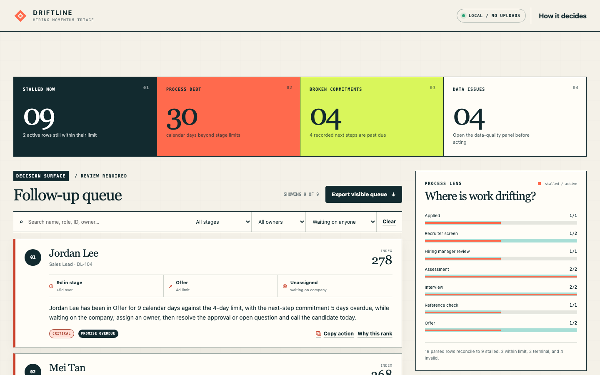

# Driftline

**A local-first hiring-board stall alerter that turns process delay into an explainable, human-reviewed follow-up queue.**

Driftline implements assignment option C. It reads a CSV, finds active applications that have not changed stage within a visible stage-aware limit, ranks the follow-up load, explains every flag in one sentence, and exports the visible queue.

It does **not** judge candidate quality, send messages, or write to an ATS. Uploaded data stays in the browser.



## Quick start

Requirements:

- Python 3 (to serve the static files)
- A modern browser
- Node.js 18+ only if you want to run tests or rebuild `dist/`

No package installation, API key, account, database, or internet connection is required.

```bash
npm start
```

Then open [http://localhost:8765](http://localhost:8765).

The built site is already included in `dist/`. To rebuild it from `src/`:

```bash
npm run build
```

To run the automated checks:

```bash
npm test
```

Expected result: **39/39 passing tests**.

To run the repeatable local engine benchmark:

```bash
npm run benchmark
```

The page also runs a lighter version automatically in the **Evidence Lab** and lets you rerun it on the current browser.

## Try the verified sample

The fictional sample loads automatically with:

- as-of date: `2026-10-12`
- base stage limit: `7` calendar days
- 18 input rows
- 9 stalled
- 2 valid active rows within limit
- 3 terminal rows excluded
- 4 invalid rows kept visible
- 30 days of process debt
- 4 overdue next-step commitments

Change the base limit to 10 days and the queue drops from 9 to 5. This is the **sensitivity check**: change one policy setting and confirm that the result changes predictably. Use the stage, owner, responsibility, and search filters; open **Why this rank** to inspect every score component; then export the visible queue. Export preserves the global ranks shown on the cards, even when filters leave gaps such as 01, 03, and 08.

## CSV contract

Dates must use `YYYY-MM-DD`. Column order does not matter. Whitespace is trimmed.

| Column | Required | Blank behavior | Affects priority? |
|---|---:|---|---:|
| `application_id` | Yes | Row is invalid | Tie-break only |
| `candidate_name` | Yes | Row is invalid | No; display only |
| `role` | Yes | Row is invalid | No; display only |
| `stage` | Yes | Row is invalid | Yes, through the stage limit |
| `stage_entered_on` | Yes | Row is invalid | Yes |
| `owner` | Header required | Shown as `Unassigned`; row can still be flagged | No |
| `waiting_on` | Yes | Row is invalid | Yes: `company`, `external`, or `candidate` |
| `last_contact_on` | No | Adds the documented 20-point “no contact recorded” component | Yes, but never resets stage age |
| `next_step_due_on` | No | No commitment component | Yes if before the as-of date |

Extra columns are ignored and reported. Sensitive-looking columns such as `gender`, `age`, `race`, `disability`, `school`, or `salary` are explicitly called out as ignored.

The browser and parser both enforce a 2 MB input ceiling. The parser also rejects more than 25,000 data rows or 64 columns. Missing or duplicate required headers fail closed: Driftline reports the structural problem and produces no ranked queue.

Recognized active stages and aliases:

- `Applied` / `Application`
- `Recruiter Screen` / `Phone Screen`
- `Hiring Manager Review` / `Hiring Manager Interview` / `Manager Review`
- `Assessment` / `Take Home`
- `Interview` / `Technical Interview` / `Onsite Interview` / `Panel Interview`
- `Reference Check` / `References`
- `Offer`

Terminal stages `Hired`, `Rejected`, and `Withdrawn` are excluded from the active queue.

## Decision rules

### 1. Effective stage limit

The visible base limit is multiplied by a stage factor and rounded up:

| Stage | Factor | Effective limit at base 7 |
|---|---:|---:|
| Applied | 1.00 | 7 days |
| Recruiter screen | 1.00 | 7 days |
| Hiring manager review | 0.75 | 6 days |
| Assessment | 1.50 | 11 days |
| Interview | 1.00 | 7 days |
| Reference check | 0.75 | 6 days |
| Offer | 0.50 | 4 days |

```text
effective limit = max(1, ceil(base limit × stage factor))
```

### 2. Stall rule

```text
days in stage = as-of date − stage_entered_on
stalled = days in stage >= effective limit
```

The cutoff is inclusive. A check-in does not reset the movement clock.

### 3. Follow-up priority

Only stalled rows enter the queue. Their index is:

```text
floor(100 × days in stage ÷ effective limit)
+ 30 if next_step_due_on is before the as-of date
+ 15 / 8 / 0 when waiting_on is company / external / candidate
+ days since last contact, capped at 20 (20 if no contact is recorded)
```

The stage-age term is deliberately uncapped, so an old case cannot be permanently hidden by smaller bonuses.

Final ordering is priority index descending, overdue commitment first, wait ratio descending, days in stage descending, then `application_id` ascending. Names and roles never affect rank.

### 4. Process debt

```text
process debt = sum(max(0, days in stage − effective limit))
```

This is overdue workflow load, not candidate risk and not a recruiter performance score.

## Validation and safety

Driftline makes data problems visible instead of silently dropping them:

- missing or malformed required values
- future stage movement dates
- a recorded next step dated before stage entry
- unknown stages
- unknown `waiting_on` values
- conflicting duplicate application IDs (every duplicate row is quarantined)
- malformed CSV field counts
- ignored and sensitive-looking extra columns

Rendered cells use text nodes, so HTML in a CSV stays inert. Exported values beginning with `=`, `+`, `-`, `@`, tab, or carriage return receive a leading apostrophe to reduce spreadsheet-formula injection risk. Queue exports also carry `NEEDS_HUMAN_REVIEW`, `WORKFLOW_DELAY_ONLY`, and the as-of date so the decision boundary survives outside the interface.

Use synthetic data for public demos. This prototype has no authentication, persistence, production privacy review, ATS integration, holiday calendar, or localization.

## Test evidence

`npm test` covers:

- quoted CSV fields, commas, Unicode, BOM, and CRLF
- missing headers and malformed row widths
- parser-level file, row, and column ceilings
- structural failures that stop ranking
- stage factors and ceiling behavior
- below / exactly at / above the inclusive threshold
- contact that does not reset stage age
- terminal-stage exclusion
- missing, invalid, and future dates
- duplicate-ID quarantine
- visible score-component arithmetic
- due-today versus overdue commitments
- deterministic ties and input-order invariance
- name / role / ignored-field score invariance
- deterministic explanations and actions
- spreadsheet-formula neutralization
- explicit human-review and workflow-only export labels
- monotonic threshold sensitivity
- fixed sample reconciliation
- an adversarial corpus with inert HTML, spreadsheet-formula protection, duplicate quarantine, and ignored sensitive columns
- deterministic benchmark generation and percentile math
- a 10,000-row analysis performance budget
- global displayed rank preservation in filtered exports
- demo reset behavior and safe browser rendering paths

### Repeatable engine benchmark

`npm run benchmark` creates deterministic synthetic CSV text once, then measures the real **CSV parse + validation + ranking** path. It uses 5 warmups and 25 measured runs per scale, keeps outliers, and reports the median, interpolated p95, throughput, and a correctness result.

Canonical release snapshot (`docs/final-evidence.json`), captured 2026-10-12 at 20:42:00 IST on Apple M2 / 8 GB / macOS 26.5.1 / Node 24.21.0:

| Rows | Median | P95 | Rows / second | Correctness |
|---:|---:|---:|---:|---:|
| 100 | 0.39 ms | 0.66 ms | 255,320 | PASS |
| 1,000 | 3.84 ms | 4.51 ms | 260,086 | PASS |
| 10,000 | 40.38 ms | 49.26 ms | 247,628 | PASS |

Data generation, file reading, and DOM rendering are outside the timer. These numbers demonstrate the prototype engine on one machine; they are not a production-capacity claim. Browser values vary and are intentionally measured again on each device.

The same release snapshot records **39/39** tests passing. Browser checks verify the sample load, adversarial demo, filters, 7→10-day sensitivity (9→5 rows), score breakdown, decision-rules dialog, data-quality panel, benchmark rerun, CSV export, and current-page console state. Automated viewport control passed at 390, 500, 821, 1180, and 1440 CSS pixels with no horizontal overflow or console warnings/errors. No physical-device or full assistive-technology audit was performed.

The page labels its automatic benchmark as a **live, non-canonical browser check**. Those numbers are expected to differ by device and run. The table above is the canonical CLI snapshot used in the release documents.

## Visual enhancement

The Evidence Lab uses an original **Signal Spotlight** treatment inspired by FreeFrontend's [Interactive Glowing Grid Cards](https://freefrontend.com/code/interactive-glowing-grid-cards-2026-03-09/). Pointer coordinates update two CSS custom properties on only the active tile; the content remains unchanged and fully usable without JavaScript. Keyboard focus gets a static halo, while touch and reduced-motion modes disable the tracking effect.

## Project structure

```text
driftline/
├── .openai/hosting.json
├── dist/                    # ready-to-serve static build
├── docs/                    # submission narratives and image
├── sample-data/
│   ├── hiring_board.csv
│   └── adversarial.csv
├── scripts/build.mjs
├── scripts/benchmark.mjs
├── src/
│   ├── app.js               # browser workflow and safe rendering
│   ├── benchmark.js         # deterministic demo generator and benchmark runner
│   ├── core.js              # parser, validation, rules, ranking, export
│   ├── index.html
│   └── styles.css
├── tests/core.test.mjs
├── tests/benchmark.test.mjs
├── tests/evidence.test.mjs
├── tests/frontend.test.mjs
└── package.json
```

## Known limits

- Calendar days only; weekends and holidays are not excluded.
- Fixed stage taxonomy and default factors; edit `STAGE_FACTORS` to change policy.
- Input is kept only in browser memory and disappears on refresh.
- Files above 2 MB, 25,000 data rows, or 64 columns are rejected before ranking.
- No ATS sync, collaboration, sign-in, automatic messages, or persistence.
- The runtime is deterministic and intentionally has no LLM; AI was used in the build-and-check process documented in `docs/five-day-log.md`.
- Browser viewport automation covered 390-1440 CSS pixels, but no physical-device or full assistive-technology audit was performed.

## Human-review boundary

Driftline organizes attention. It does not decide who advances or gets rejected. Every explanation and recommended action must be checked against the real hiring record before a person acts.
